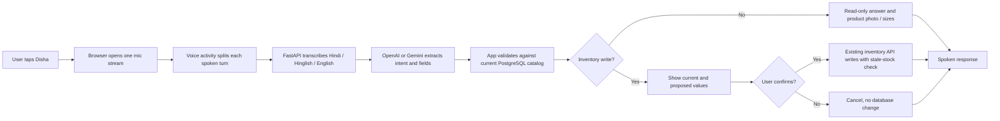

# Disha: Hindi-English voice aur inventory architecture

## Recommended request path



The model understands language and extracts a requested action. FastAPI remains the source of truth for names, colors, sizes, stock, alerts, orders, and sales. The model must never invent a stock number or directly write to the database. Stock changes, product CRUD, restore/delete, and dispatch remain action-card operations with explicit confirmation.

## What runs where

- The web UI, FastAPI application, and PostgreSQL can run on Railway or on the same laptop for local development.
- The current voice path captures audio only after the user taps the robot button. A single microphone stream remains open during the session; short utterance recordings go to the transcription endpoint. Pause, closing Disha, or hiding the tab stops all tracks.
- Audio transcription and generated spoken replies use the server-side OpenAI key. Text intent parsing can use OpenAI with Gemini fallback. Keys stay in Railway Variables or a local ignored `.env`; never put keys in browser JavaScript or Git.
- If provider credits or network are unavailable, voice can fail; text chat and normal inventory pages remain usable. The browser speech voice is a fallback.

## Why the two linked translation repositories are not the Disha model

The linked projects are machine-translation demos, not conversational agents. The first is an English-to-Hindi Keras encoder/decoder project trained on short parallel sentences; the second is Hindi-to-English PyTorch notebook work. They translate one language direction and do not understand inventory actions, preserve multi-turn context, look up live stock, or ask for safe confirmations. Training those weights would not give Disha CRUD or conversational abilities, and could make Hindi-English code-switching worse.

For reliable Hindi/Hinglish and English inventory work, keep the multilingual language model as the intent/conversation layer and teach it with a versioned prompt plus a representative evaluation set. Use application code for smart catalog search, permissions, calculations, and writes. Add training/fine-tuning only after collecting reviewed, consented examples and measuring intent accuracy, correct product/size matching, false confirmations, and response quality.

## Same-laptop development

On Windows, open PowerShell in the repository folder and run:

```powershell
py -m venv .venv
.\.venv\Scripts\Activate.ps1
pip install -r requirements.txt
if (-not (Test-Path .env)) { Copy-Item .env.example .env }
Set-Location backend
python -m uvicorn main:app --reload --port 8000
```

Then open `http://localhost:8000/app/`. Keep `OPENAI_API_KEY` in the ignored root `.env`; set `GEMINI_API_KEY` there too if you want text-intent fallback. Railway uses service Variables instead. Do not commit or paste keys into chat. If PowerShell blocks activation, use `\.venv\Scripts\python.exe -m pip install -r requirements.txt` and `\.venv\Scripts\python.exe -m uvicorn main:app --reload --port 8000` without activating the environment.

Local app use still calls paid cloud APIs for model, transcription, and TTS. “Runs on the laptop” does not mean “offline.” A fully offline mode is a separate deployment profile: local speech recognition, a multilingual local language model, and local TTS each need their own model weights, memory/CPU/GPU measurements, packaging, and tests. The two linked NMT repos are not suitable offline Disha chat models.

## Voice reference

Disha uses a built-in warm, friendly voice style. The uploaded clip is not cloned: exact voice replication needs the speaker's authorization and a supported consent workflow. If an exact licensed voice is needed, obtain the speaker's explicit consent and use a provider-approved custom voice flow.
