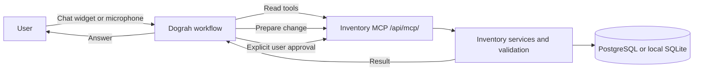

# Dograh integration architecture

Dograh is the inventory app's conversational agent. The Dograh service runs separately (Dograh Cloud or a self-hosted Dograh deployment); this repository embeds its website widgets and exposes inventory features through a protected MCP endpoint.



## Components

- `frontend/` loads the public Dograh Chat/Headless widget and, when configured, the separate Voice/Headless widget. It never receives the MCP API key.
- `backend/main.py` publishes `/api/dograh/runtime-config`, which returns only validated public widget URLs, and mounts the protected Streamable HTTP endpoint at `/api/mcp/`.
- `backend/dograh_mcp.py` provides live product, size-wise stock, alert, reorder, order, dispatch, and analytics tools. It uses the same inventory service/database as the app.
- `DOGRAH_MCP_API_KEY` authenticates MCP requests and signs short-lived action confirmations. Keep it only in Railway Variables/local ignored `.env` and the Dograh credential vault.

Dograh can use only the actions exposed by these MCP tools. It does not receive raw SQL, database credentials, operating-system access, access to other desktop apps, personal notifications, or unrestricted WhatsApp access. WhatsApp support creates a user-reviewed draft. Browser widgets cannot control the host PC.

## Changes and dispatch safety

Live stock/order facts must come from MCP. For a change or dispatch, the agent prepares a specific action, shows the affected product/SKU, size and quantity, then waits for a clear user approval. A separate confirmation applies that exact prepared change. Confirmation tokens expire after ten minutes and stale stock/order state is rejected. Never test a write or dispatch against production data without an explicitly approved real action.

## Local development

Dograh is a separate service and is not bundled into this repository. Set the Dograh Chat widget URL in the root `.env` (copy `.env.example`) to test text chat. Voice requires its own Dograh Voice/Headless URL. Do not commit `.env` or any API key.

```powershell
py -m venv .venv
.\.venv\Scripts\Activate.ps1
pip install -r requirements.txt
Copy-Item .env.example .env
Set-Location backend
python -m uvicorn main:app --reload --port 8000
```

Open `http://localhost:8000/app/`. The normal inventory app remains usable if the Dograh service/widget is unavailable; the assistant reports a connection/setup issue.

## Language and voice

The app passes a language hint to Dograh, but recognition and spoken languages depend on the transcriber and TTS provider selected in the Dograh workflow. Configure multilingual auto-detection and Hindi/English-capable speech, then test Devanagari Hindi, Roman Hindi/Hinglish, English, and language switching in the Dograh preview. App code cannot repair provider pronunciation or add an unsupported language.

See [Dograh integration steps](DOGRAH_INTEGRATION_HI.md) and the [user manual](DOGRAH_USER_MANUAL_HI.md).
